# Veneer

[](https://pub.dev/packages/veneer)
[](https://github.com/troyvnit/veneer/actions/workflows/ci.yml)
[](https://pub.dev/packages/veneer/score)
[](https://pub.dev/packages/veneer/score)
[](#platform-support)
[](LICENSE)

**Real native iOS 26 UI for Flutter apps — Liquid Glass, UIKit bars, sheets, menus and composers —
driven by your Flutter widget tree, with matching Flutter UI on Android and older iOS.**

<p align="center">
  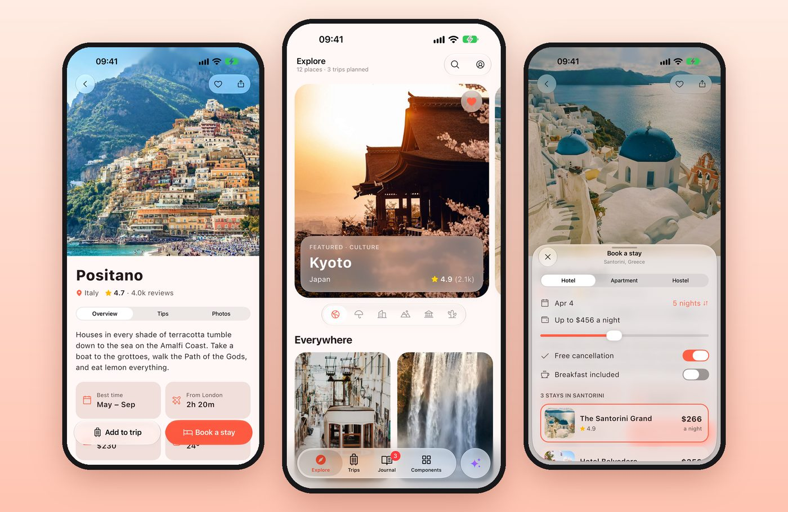
</p>

Veneer puts real UIKit on screen where your Flutter widgets say it should be. The tab bar is a real
`UITabBarController`, the navigation bar a real `UINavigationBar`, sheets are real
`UISheetPresentationController` sheets, and glass is real `UIGlassEffect` bending your Flutter pixels —
with UIKit's own animations, gestures and accessibility. You write ordinary Flutter widgets; on
Android and iOS 15–25 the same tree renders Flutter replicas, so one codebase serves every platform.

**[Components](doc/components.md)** · **[Example app](example)** · **[How it works](doc/architecture.md)** ·
**[Changelog](CHANGELOG.md)**

<table>
  <tr>
    <td width="290" align="center">
      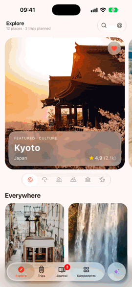
      <br><sub><a href="https://github.com/troyvnit/veneer/raw/main/doc/demo.mp4">Full-quality video</a></sub>
    </td>
    <td>
      <b>What you're watching</b> — the example app on the iOS 27 simulator, in real time:
      <ul>
        <li>Photos scroll under a <b>glass segment bar</b> that pins below the <b>native navigation
        bar</b>, and under glass labels laid out by Flutter.</li>
        <li>A pushed page runs its photo under the bar; the <b>glass bar buttons</b> sit right on it.</li>
        <li>“Book a stay” opens a <b>real UIKit sheet</b> with a medium and a large detent, holding
        Flutter content with a native <b>segmented control, slider and switches</b>.</li>
        <li>The <b>tab bar</b> slides away under the pushed page and comes back with it.</li>
      </ul>
      Every frame, native views move with the Flutter pixels under them: one synchronous
      <code>dart:ffi</code> call after Flutter paints.
    </td>
  </tr>
</table>

## Why Veneer

- **The real thing, not a look-alike.** Flutter's Cupertino widgets imitate iOS; Veneer *is* iOS. Bars,
  sheets, menus, alerts, banners, controls and Liquid Glass come from UIKit, so they look, move and
  feel exactly like the system — including what Apple changes next.
- **One widget tree.** `NativeNavigationBar`, `NativeComposer`, `GlassShape` and friends are plain
  widgets. No platform checks, no second UI for Android.
- **In sync with Flutter.** Glass follows scrolling, clips and route transitions in the same frame as
  the content under it, and merges and morphs the way native glass does.
- **Ready for big screens.** Split layouts give each column its own navigation bar, and the tab bar
  becomes a side column on the unfolded iPhone Duo.

> **Status: pre-1.0.** The API may still change between minor versions; every change is in the
> [changelog](CHANGELOG.md). Verified on the iOS 26 and 27 simulators (iPhone and the iPhone Duo,
> folded and unfolded) and the Android emulator; real-device performance measurements are still to come.

## Native and Flutter, side by side

<table>
  <tr>
    <td align="center">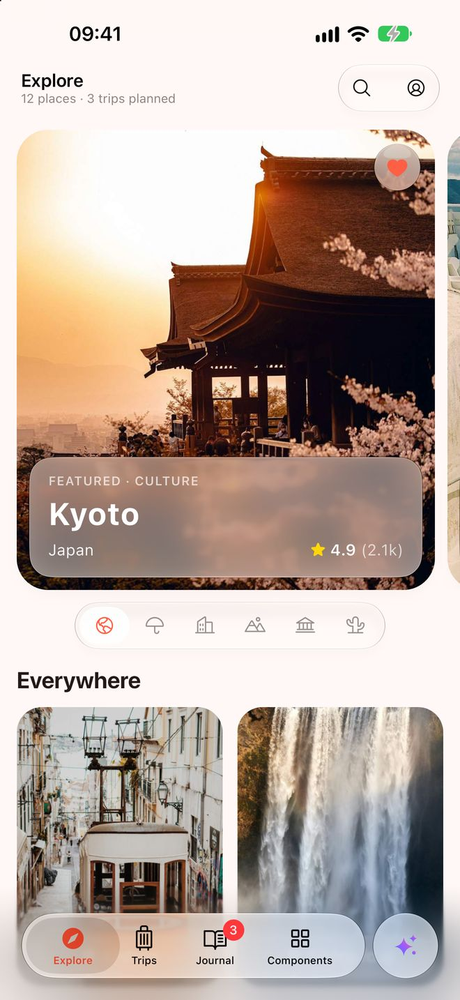<br><sub><b>iOS 26+</b> — UIKit and Liquid Glass</sub></td>
    <td align="center">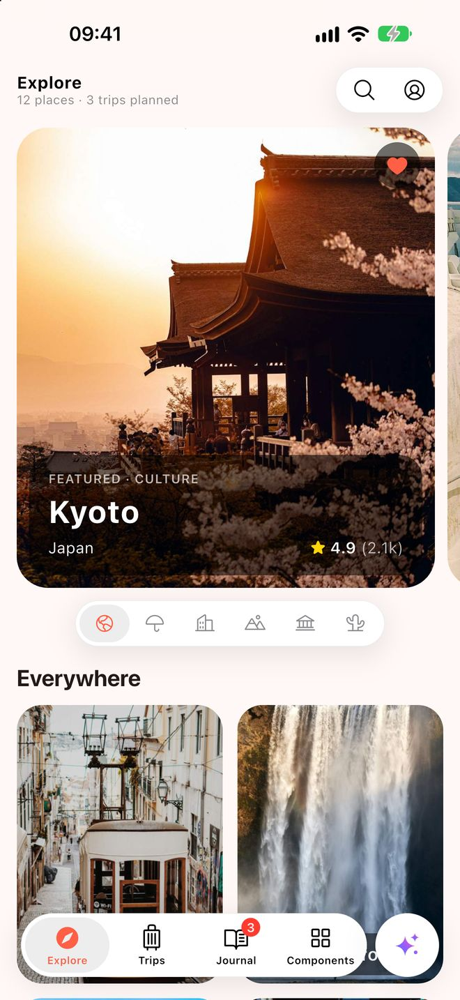<br><sub><b>Android, iOS 15–25</b> — Flutter replicas</sub></td>
  </tr>
</table>

The same widget tree, with no platform checks. The replicas match the native layout, sizes and corner
radii, with solid surfaces instead of glass. The example app has a **Flutter replicas** switch to flip
between the two at runtime.

## Gallery

<table>
  <tr>
    <td align="center" valign="top"><a href="doc/components.md#navigation-bar">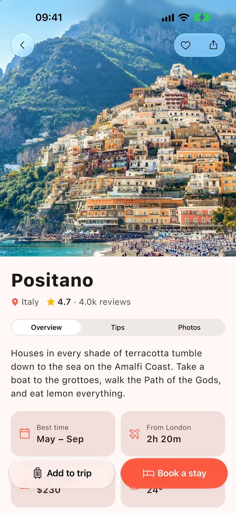</a><br><sub><b>Navigation bar</b><br>Glass buttons over content</sub></td>
    <td align="center" valign="top"><a href="doc/components.md#sheets">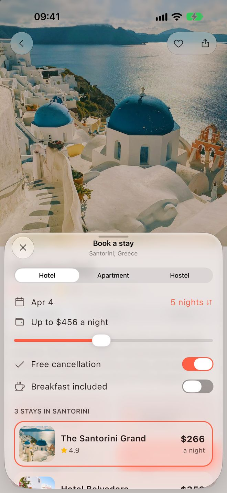</a><br><sub><b>Sheets and controls</b><br>A UIKit sheet with Flutter inside</sub></td>
    <td align="center" valign="top"><a href="doc/components.md#menus">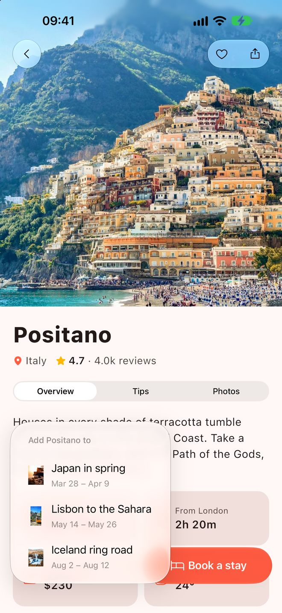</a><br><sub><b>Menus</b><br>From glass, bars and any widget</sub></td>
  </tr>
  <tr>
    <td align="center" valign="top"><a href="doc/components.md#composer">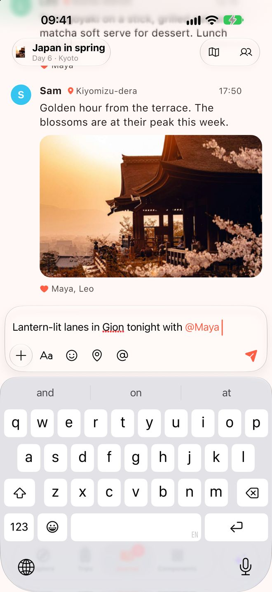</a><br><sub><b>Composer</b><br>Morphs with the keyboard</sub></td>
    <td align="center" valign="top"><a href="doc/components.md#prompt-composer">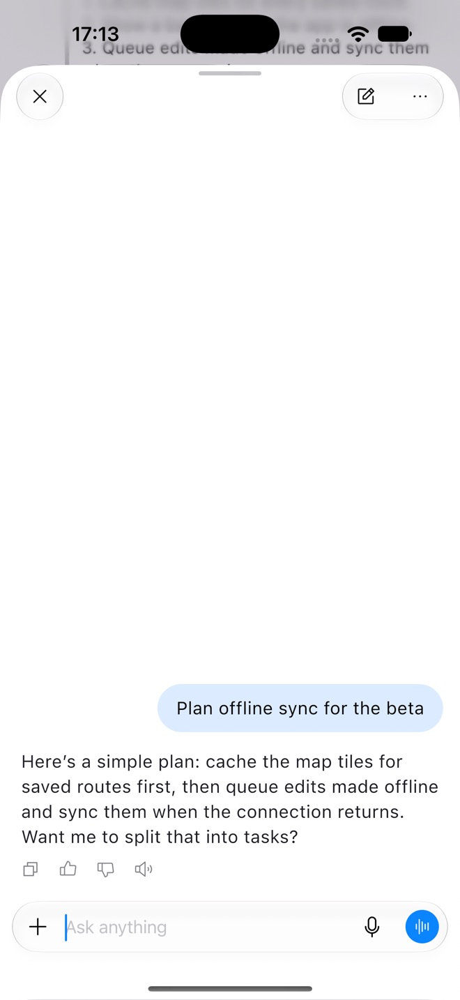</a><br><sub><b>Prompt composer</b><br>An assistant in a sheet</sub></td>
    <td align="center" valign="top"><a href="doc/components.md#banners">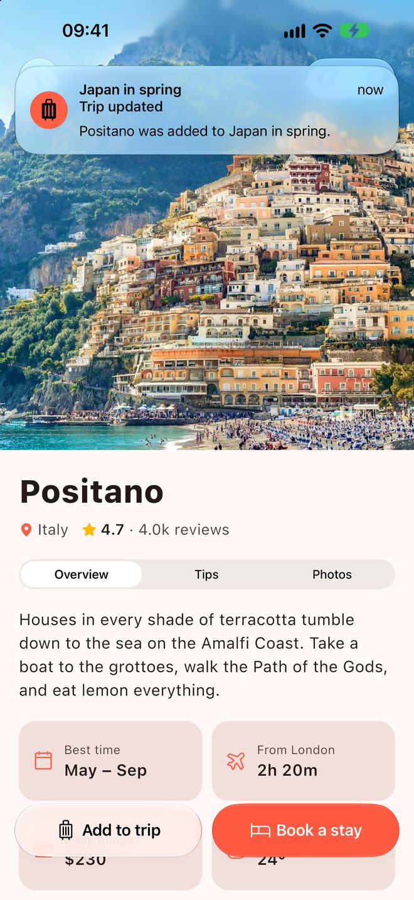</a><br><sub><b>Banners</b><br>Above bars and sheets</sub></td>
  </tr>
  <tr>
    <td align="center" valign="top"><a href="doc/components.md#glass-shapes">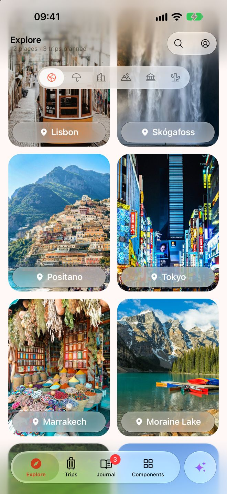</a><br><sub><b>Glass</b><br>Laid out by Flutter, refracting it</sub></td>
    <td align="center" valign="top"><a href="doc/components.md#controls-and-alerts">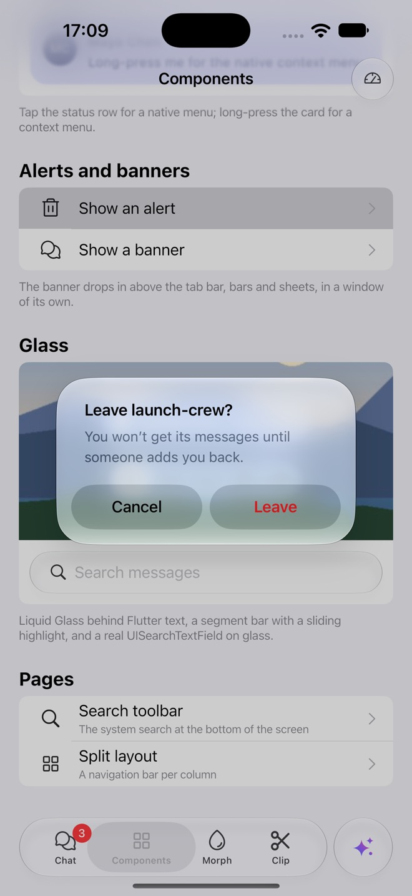</a><br><sub><b>Alerts</b><br><code>UIAlertController</code>, tinted</sub></td>
    <td align="center" valign="top"><a href="doc/components.md#tab-bar">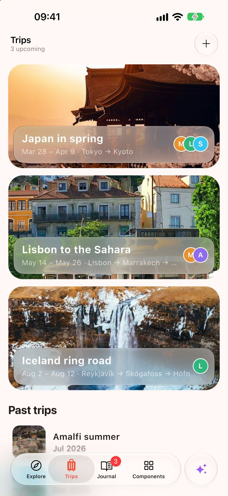</a><br><sub><b>Tab bar</b><br>With a trailing action</sub></td>
  </tr>
</table>

### Built for the iPhone Duo

<p align="center">
  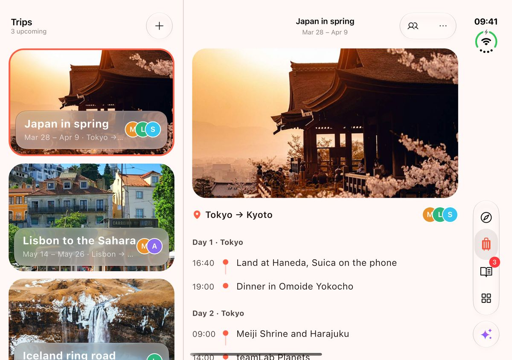
</p>

Unfold an iPhone Duo and the same widget tree becomes a two-column app. `NativeChromePane` gives each
column its own `UINavigationBar` and scroll edge effects; the tab bar moves to a glass column at the
trailing edge and reports its inset, so content stays clear of it. See
[Split layouts](doc/components.md#split-layouts).

## Installation

```bash
flutter pub add veneer
```

Or track the repository directly:

```yaml
dependencies:
  veneer:
    git:
      url: https://github.com/troyvnit/veneer.git
      ref: main
```

Requirements:

- Flutter 3.47 or later (Dart 3.13).
- iOS deployment target **15.0** or later. The native layer turns on at runtime on iOS 26+.
  Build with Xcode 26 or later so the iOS 26 SDK is available. Xcode 27 adds the parts that need the
  iOS 27 SDK: the tab bar's prominent action tab and selected tab icons.
- Works with CocoaPods and Swift Package Manager. No Android setup.

## Quick start

Wrap your pages in a `NativeChromeScope` for the tab bar, and register the navigator
observer so native chrome steps aside for Flutter dialogs and bottom sheets:

```dart
import 'package:veneer/veneer.dart';

class App extends StatelessWidget {
  const App({super.key});

  @override
  Widget build(BuildContext context) => MaterialApp(
    navigatorObservers: [VeneerNavigatorObserver()],
    home: const Home(),
  );
}

class Home extends StatefulWidget {
  const Home({super.key});

  @override
  State<Home> createState() => _HomeState();
}

class _HomeState extends State<Home> {
  int _tab = 0;

  @override
  Widget build(BuildContext context) => NativeChromeScope(
    tabs: const [
      NativeTabItem(title: 'Home', icon: NativeIcon.symbol('house'), selectedIcon: NativeIcon.symbol('house.fill')),
      NativeTabItem(title: 'Inbox', icon: NativeIcon.symbol('tray'), badge: '3'),
    ],
    selectedIndex: _tab,
    onTabSelected: (i) => setState(() => _tab = i),
    child: IndexedStack(index: _tab, children: const [HomePage(), InboxPage()]),
  );
}
```

Pages add a navigation bar by wrapping their content. Content gets `MediaQuery` padding for the
bars, so it starts below them and scrolls underneath:

```dart
class InboxPage extends StatelessWidget {
  const InboxPage({super.key});

  @override
  Widget build(BuildContext context) => Scaffold(
    body: NativeNavigationBar(
      title: const NativeBarTitle(title: 'Inbox'),
      trailing: [NativeBarButton(icon: const NativeIcon.symbol('square.and.pencil'), title: 'New', onPressed: () {})],
      child: Builder(
        builder: (context) => ListView(padding: MediaQuery.paddingOf(context), children: const [/* … */]),
      ),
    ),
  );
}
```

## Components

| Widget | What it is |
|---|---|
| [`NativeChromeScope`](doc/components.md#tab-bar) | A real `UITabBarController`: the floating Liquid Glass bar, selection morph, badges and a detached trailing action. Slides away when another screen covers it. |
| [`NativeNavigationBar`](doc/components.md#navigation-bar) | A real `UINavigationBar`: glass bar buttons, title capsules, grouped buttons, native menus and iOS 26's scroll edge effect over Flutter content. |
| [`NativeChromePane`](doc/components.md#split-layouts) | Split layouts: a navigation bar per column, and routes that show in one pane. |
| [`NativeComposer`](doc/components.md#composer) | A messaging composer that morphs into a card above the keyboard, with mentions and voice recording. |
| [`NativePromptComposer`](doc/components.md#prompt-composer) | An assistant composer: attachments, a voice button that becomes send, and a voice session. |
| [`showNativeSheet`](doc/components.md#sheets) | Real UIKit sheets hosting Flutter: detents, grabber, Liquid Glass at partial heights. |
| [`NativeMenuAnchor`, `NativeContextMenu`](doc/components.md#menus) | `UIMenu`s from any Flutter widget, and context menus on long-pressed widgets. |
| [`GlassShape`, `GlassGroup`, `GlassBackground`](doc/components.md#glass-shapes) | `UIGlassEffect` laid out by Flutter: merging, clipped, interactive, or behind Flutter content. |
| [`NativeSearchField`](doc/components.md#search-field), [`NativeSearchToolbar`](doc/components.md#search-toolbar) | A glass search field, and the system search bar at the bottom of the screen. |
| [`GlassSegmentBar`](doc/components.md#segment-bar) | A row of icons on one glass capsule with a sliding highlight. |
| [`NativeSwitch`, `NativeSlider`, `NativeSegmentedControl`, `showNativeAlert`](doc/components.md#controls-and-alerts) | UIKit's controls and alerts, laid out by Flutter. |
| [`showNativeBanner`](doc/components.md#banners) | In-app notification banners on Liquid Glass, above the app's bars and sheets. |
| [`NativeIcon`](doc/components.md#icons) | SF Symbols, any `IconData`, SVG and images, all rendered natively. |

The full reference, with every option and an example for each, is in
**[doc/components.md](doc/components.md)**.

## Platform support

| Platform | What renders |
|---|---|
| **iOS 26+** | The native layer: UIKit bars, sheets and composers, Liquid Glass, scroll edge effects |
| **iOS 15–25, Android** | Flutter replicas of the same UI, matching layout, sizes, positions, colours and corner radii, with solid surfaces instead of glass |
| Web, desktop | Not supported (the bridge uses `dart:ffi`) |

`Veneer.isSupported` tells you which path is active. You rarely need it: every widget picks
its own path, so app code needs no `Platform.isIOS` checks.

## Android and older iOS

Where the native layer isn't available, every widget renders a Flutter replica with the
native layout, sizes, positions and corner radii, iOS system colours, and solid surfaces
instead of glass. It follows light and dark mode.


To preview the replicas on an iOS 26 device, set `Veneer.debugForceFallback = true` before
`runApp` (the example's **Flutter replicas** switch does this at runtime, remounting the app). Wrap
any subtree in `VeneerFallbackScope` to force its replicas.

To match your design system, add a `VeneerFallbackStyle` to your theme's `extensions` (one per
brightness); the replicas read their surfaces, labels, accent, badge colours and shadows from it:

```dart
ThemeData(extensions: [
  VeneerFallbackStyle.iosLight.copyWith(accent: brand, surface: card, shadows: brandShadow),
])
```

A Flutter sheet given a `backgroundColor` stays solid at every detent; pass a
`CupertinoDynamicColor` to have it follow light and dark mode while it's open.

## Limitations

- **Z-order:** native glass and chrome always draw above Flutter content, so their content has
  to be native. Flutter popups are handled (chrome steps aside); arbitrary `Overlay`s aren't.
- **Clips:** one rounded clip per shape is exact; `ClipPath` counts as its bounding box. Shapes
  under different clips don't merge. Opaque Flutter widgets painted over glass don't hide it.
- **Route transitions:** the tab bar slides away under pushed routes, but the navigation bar
  and composer switch at the start of a push instead of sliding with the page.
- **Sheets:** the sheet's Flutter content runs in its own isolate (see [Sheets](doc/components.md#sheets)).
- **Gestures:** a touch that starts on an interactive glass shape belongs to UIKit and can't
  start a Flutter scroll.
- **Context menus:** the lifted preview is a still snapshot, so animated content freezes while
  the menu is up.
- **Accessibility:** not yet audited with VoiceOver.
- **Not yet native:** toolbars.

## Example app

The [example](example) is **Wander**, a travel journal that uses every component:

```bash
cd example
flutter run
```

- **Explore:** featured places on glass cards, a glass category bar that pins under the navigation
  bar, and a grid of photos with glass labels and native context menus. Search opens the native search
  toolbar.
- **Place pages:** the photo runs under the bar; glass buttons open a native menu of trips and a
  **Book a stay** sheet with native controls, an alert and a banner.
- **Trips:** a list and its detail; side by side on wide screens like the unfolded iPhone Duo.
- **Journal:** the native composer with a toolbar, mentions and voice notes.
- **Components:** each component on its own, merging and clipped glass, the **Lab** (icon types,
  sync timing) and the **Flutter replicas** switch.
- **Assistant** (the tab bar's trailing button): a trip planner in a native sheet with the prompt
  composer.

Photos are from [Unsplash](https://unsplash.com) (credits in the [example's README](example/README.md));
icons are [Phosphor Icons](https://phosphoricons.com) (MIT).

## How it works

Veneer adds one transparent native view above the `FlutterView`. Flutter widgets register
anchors; once per frame, after Flutter lays out and paints, Veneer collects every anchor's
rect, visibility and clip and hands them to UIKit in a single synchronous `dart:ffi` call, so
native views move in the same frame as the Flutter pixels under them. Bars, composers and
sheets are UIKit components configured from Dart. Touches pass through to Flutter except where
they land on native controls.

See [doc/architecture.md](doc/architecture.md) for the design, the per-frame path, measured
results and the rules learned along the way.

## Contributing

Issues and pull requests are welcome. CI checks formatting, analysis and the Dart tests on the
oldest supported Flutter and the latest stable, builds the example for iOS with Xcode 26 and Xcode 27
(which compiles the Swift code against both SDKs) and runs the Swift tests. Before sending a change:

```bash
dart format lib test example/lib
tool/analyze.sh            # the package and the example
flutter test
cd example && flutter build ios --simulator --debug
cd ios && xcodebuild test -workspace Runner.xcworkspace -scheme Runner \
  -destination 'platform=iOS Simulator,name=iPhone 17' -only-testing:RunnerTests
```

`tool/analyze.sh` fails on any analyzer issue except Flutter's notice that `material.dart` and
`cupertino.dart` are moving to the `material_ui` and `cupertino_ui` packages; veneer keeps the framework
imports while it supports Flutter releases from before that move.

## License

MIT — see [LICENSE](LICENSE).
