# Components

Every Veneer widget, with its options and a short example. Each one renders natively on iOS 26 and
later and as a Flutter replica on Android and iOS 15–25 (see the
[README](../README.md#android-and-older-ios)). The screenshots are from the
[example app](../example).

[Tab bar](#tab-bar) · [Navigation bar](#navigation-bar) · [Split layouts](#split-layouts) · [Composer](#composer) · [Prompt composer](#prompt-composer) · [Sheets](#sheets) · [Menus](#menus) · [Glass shapes](#glass-shapes) · [Search field](#search-field) · [Search toolbar](#search-toolbar) · [Segment bar](#segment-bar) · [Controls and alerts](#controls-and-alerts) · [Banners](#banners) · [Icons](#icons)

## Tab bar

<p>
  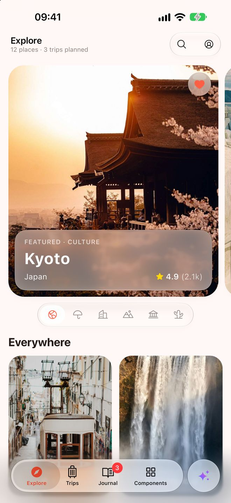
</p>

```dart
NativeChromeScope(
  tabs: const [
    NativeTabItem(title: 'Chat', icon: NativeIcon.symbol('bubble.left'), selectedIcon: NativeIcon.symbol('bubble.left.fill')),
    NativeTabItem(title: 'Library', icon: NativeIcon.icon(Icons.photo_library_outlined), badge: '3'),
  ],
  trailingAction: NativeTabAction(icon: NativeIcon.symbol('sparkles'), title: 'Assistant', onPressed: openAssistant),
  scrollEdgeEffect: NativeScrollEdgeEffect.soft,
  selectedIndex: index,
  onTabSelected: (i) => setState(() => index = i),
  child: pages,
)
```

- A real `UITabBarController`, so the glass bar, selection animation, badges, VoiceOver and the
  large content viewer are UIKit's. Icons, titles and badges update in place.
- **Split layout:** `trailingAction` becomes the detached glass button at the trailing edge. It
  acts as a button by default; with `selectable: true` it's a tab reported as index `tabs.length`.
- Up to **5 items** including the trailing button (UIKit's limit on iPhone before a "More" tab).
- Slides away while another route covers its page, and while a Flutter popup shows (with
  `VeneerNavigatorObserver`).

## Navigation bar

<p>
  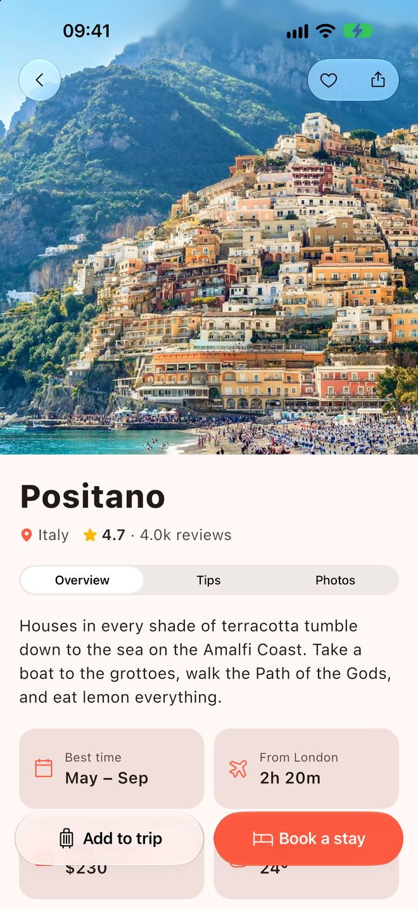
</p>

```dart
NativeNavigationBar(
  leading: NativeBarButton(icon: const NativeIcon.symbol('chevron.left'), title: 'Back', onPressed: pop),
  title: NativeBarTitle(title: 'launch-crew', subtitle: '6 members', icon: const NativeIcon.symbol('lock.fill'), capsule: true),
  trailing: [
    NativeBarButton(icon: const NativeIcon.symbol('headphones'), title: 'Huddle', onPressed: huddle),
    NativeBarButton(icon: const NativeIcon.symbol('ellipsis'), title: 'More', menu: moreItems),
  ],
  child: page,
)
```

- A real `UINavigationBar`: 44 pt glass buttons, and adjacent trailing buttons sharing one glass
  capsule. When its buttons change, UIKit morphs the glass between the old and new sets.
- `NativeBarTitle(capsule: true)` shows a tappable glass capsule with an icon, title,
  subtitle and optional `accessory` (such as a chevron), like a channel header; otherwise a
  plain title, centred or leading (`alignment: NativeBarTitleAlignment.leading`). With
  `fill: true` the capsule spans the space between the buttons (a chat header), and `iconSize`
  fits an avatar-sized icon such as a group avatar. Pass `style`
  and `subtitleStyle` to use your app's fonts and colours; the native bar loads the font
  family from your Flutter assets.
- Bar buttons can show a `badge` (a count, text, or `''` for a dot), use `prominent` tinted
  glass, show text instead of an icon, and split into separate capsules with `group`.
- **Scroll edge effect:** content dissolves into iOS 26's own progressive blur under the bar
  (`scrollEdgeEffect`, soft by default).
- Shown while its page is visible; the most recently shown bar wins.

## Split layouts

<p>
  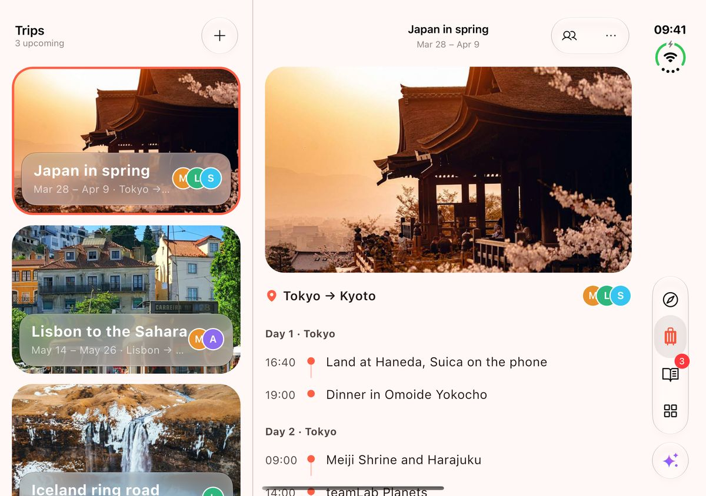
</p>

```dart
Row(children: [
  SizedBox(
    width: 375,
    child: NativeChromePane(id: 'list', left: 0, width: 375, child: listWithTabs),
  ),
  Expanded(
    child: NativeChromePane(id: 'detail', left: 376, width: screenWidth - 376, child: detail),
  ),
])
```

- Each `NativeChromePane` gets its own navigation bar and scroll edge effects, spanning only its
  columns. `left` and `width` are where the pane rests, in logical pixels from the left of the
  Flutter view; chrome doesn't follow a route transition sliding the pane's content.
- A `NativeChromeScope` inside a pane confines the tab bar to it, as a bottom bar sized for the
  pane. A composer inside a pane is laid out for the pane's width.
- Routes that show in one pane mix in `NativePaneRoute` and report the pane's id in
  `nativePane` (null while they cover the whole screen). Pages in other panes then stay
  uncovered. The navigator needs a `VeneerNavigatorObserver`.

## Composer

<p>
  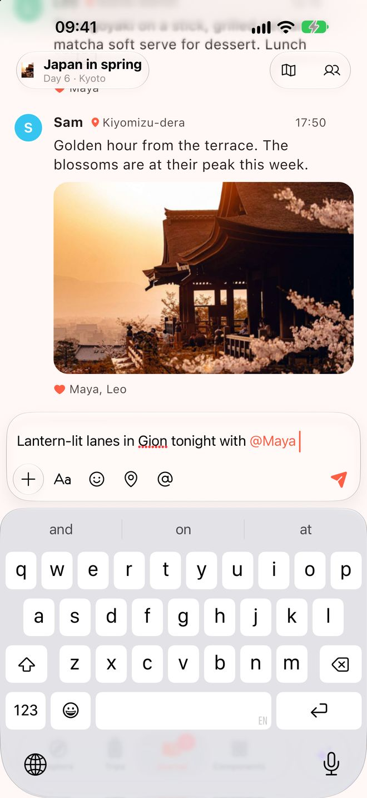
</p>

A messaging composer for chat screens:

```dart
NativeComposer(
  controller: composer,
  placeholder: 'Message launch-crew',
  leading: NativeComposerButton(icon: const NativeIcon.symbol('plus'), title: 'Attach', onPressed: attach),
  idleAction: NativeComposerButton(icon: const NativeIcon.symbol('mic'), title: 'Voice message'),
  toolbar: [
    NativeComposerButton(icon: const NativeIcon.symbol('textformat'), title: 'Formatting'),
    NativeComposerButton(icon: const NativeIcon.symbol('face.smiling'), title: 'Emoji'),
  ],
  onSend: send,
  child: ListView(reverse: true, children: messages),
)
```

- Idle, a 44 pt glass capsule above the tab bar. Focused, it morphs into a card above the
  keyboard with a toolbar row and send button, inside the keyboard's own animation.
- The text view grows to `maxLines`, then scrolls. `NativeComposerController` reads and sets
  the text and focus.
- **Interactive keyboard dismissal:** dragging the content down pulls the keyboard with the
  finger, using UIKit's own mechanism, while Flutter keeps scrolling.
- Use it in a `Scaffold(resizeToAvoidBottomInset: false)`: it handles the keyboard and pads
  `child` for the space it takes.
- **Mentions:** `controller.selection` follows the caret, `controller.replaceRange(start, end,
  '@Name ')` completes the mention being typed, and `highlights: ['@Name']` draws mentions in
  the tint colour.
- **Voice recording** (both composers), as in Slack:

  ```dart
  NativePromptComposer(
    controller: composer,
    actions: [
      NativeComposerButton(
        icon: const NativeIcon.symbol('mic'),
        title: 'Record',
        onPressed: () => composer.startVoiceRecording(maxDuration: const Duration(minutes: 5)),
      ),
    ],
    onVoiceRecorded: (clip) => attach(clip.path, clip.duration),
    onVoiceRecordingFailed: (reason) => recordWithFlutter(),
    recordingCancelLabel: 'Cancel',
    recordingDoneLabel: 'Done',
    child: conversation,
  )
  ```

  The composer becomes a recording bar with cancel, a live waveform, the elapsed time and done.
  Recording is native: an AAC `.m4a` file in the temporary directory, which your app owns from
  then on. Your app needs an `NSMicrophoneUsageDescription`. The Flutter fallback reports
  `NativeVoiceRecordingFailure.unavailable`.

## Prompt composer

An assistant-style composer:

<p>
  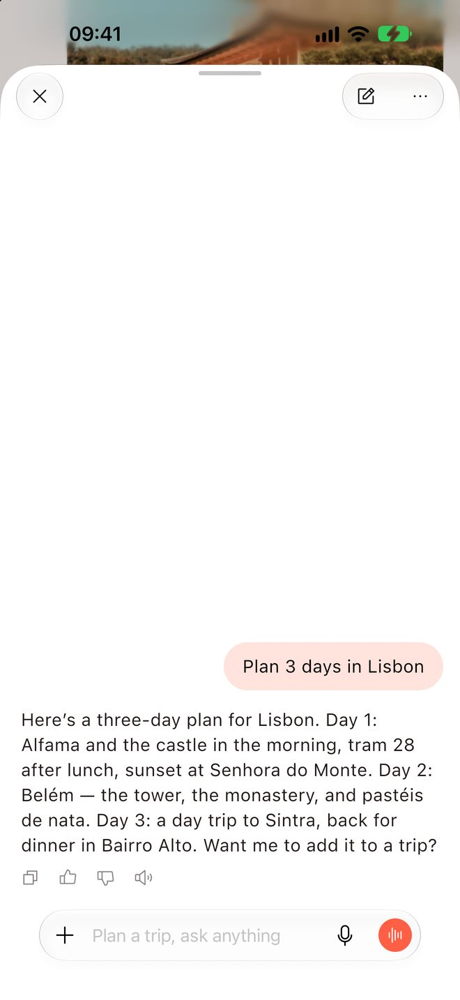
</p>

```dart
NativePromptComposer(
  controller: composer,
  placeholder: 'Ask anything',
  leading: NativeComposerButton(icon: const NativeIcon.symbol('plus'), title: 'Add', menu: [
    NativeMenuItem(title: 'Photos', icon: const NativeIcon.symbol('photo.on.rectangle'), onSelected: pickPhoto),
    NativeMenuItem(title: 'Files', icon: const NativeIcon.symbol('doc'), onSelected: pickFile),
  ]),
  actions: [NativeComposerButton(icon: const NativeIcon.symbol('mic'), title: 'Dictate', onPressed: dictate)],
  primaryAction: NativeComposerButton(
    icon: const NativeIcon.symbol('waveform'),
    title: 'Voice mode',
    onPressed: () => setState(() => voice = true),
  ),
  sideActions: [
    NativeComposerButton(icon: const NativeIcon.symbol('mic.slash'), title: 'Mute', onPressed: toggleMute),
    NativeComposerButton(
      icon: const NativeIcon.symbol('xmark'),
      title: 'End',
      prominent: true,
      onPressed: () => setState(() => voice = false),
    ),
  ],
  showSideActions: voice,
  attachments: [
    NativeComposerAttachment(id: 'p1', thumbnail: NativeIcon.imageFile(photoPath), onRemove: () => remove('p1')),
  ],
  onSend: send,
  child: conversation,
)
```

- **One line (48 pt):** leading button, text, inline actions and a filled circle that shows
  `primaryAction` while empty and becomes **send** once there's text or an attachment.
- **Multi-line:** when the text wraps, has a line break or there are attachments, the capsule
  grows into a card with attachments on top and the buttons on a bottom row.
- **Side actions:** glass circles that split off the capsule like liquid while
  `showSideActions` is true (for example a voice session's mute and end buttons).
- **Attachments:** image tiles (no `title`) or file chips, with remove buttons; `loading`
  dims a tile and shows a spinner while it uploads, and `onTap` makes the tile itself tappable
  (to preview or play it).
- **States:** `stopAction` replaces the circle while a reply is generating, `sendEnabled` and
  `sendBusy` hold or spin the send button, and `editable: false` shows text (such as a live
  transcript) without taking the keyboard.
- Idle, it sits concentric with the display's corners; focused, it rides the keyboard.

## Sheets

Real UIKit sheets for Flutter content:

<p>
  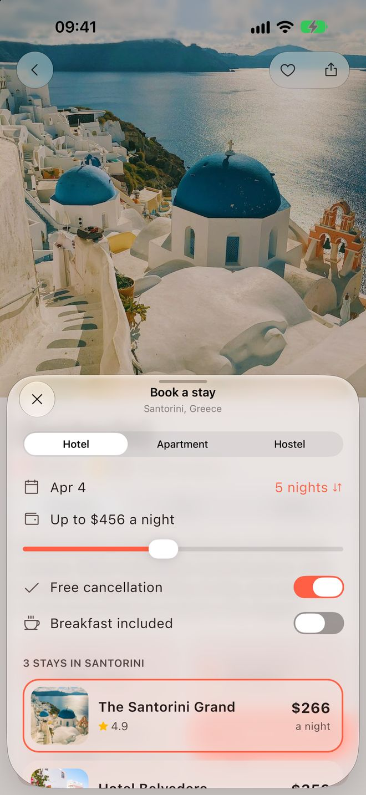
  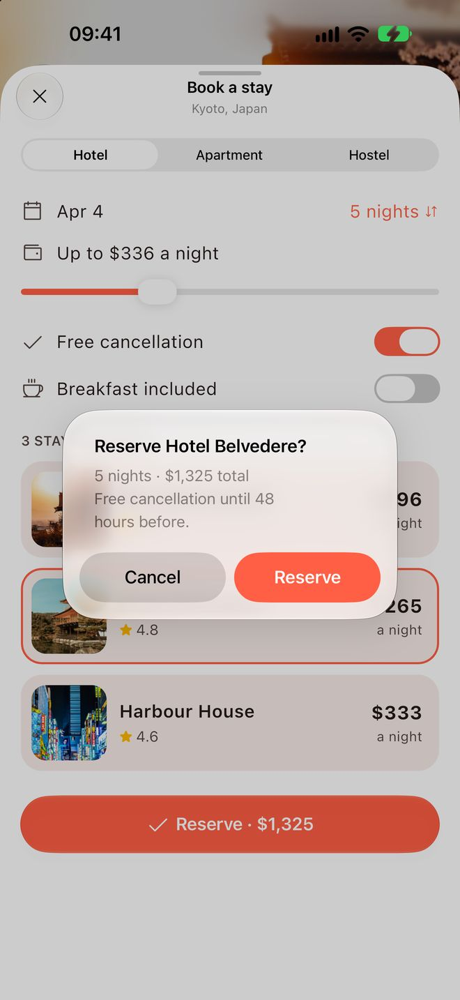
</p>

```dart
// main.dart: the sheet's Flutter app
@pragma('vm:entry-point')
void assistantSheet() => runNativeSheet(
  MaterialApp(theme: appTheme, home: const AssistantPage()),
);

// Warm it up early so the sheet opens with content:
NativeSheet.prewarm('assistantSheet');

// Present it:
showNativeSheet<void>(
  context: context,
  entrypoint: 'assistantSheet',
  detents: const [NativeSheetDetent.medium, NativeSheetDetent.large],
  initialDetent: NativeSheetDetent.large,
  builder: (context) => const AssistantPage(), // Android / iOS 15–25
);

// Inside the sheet:
NativeSheet.close(context, result);
```

- On iOS 26 this presents a `FlutterViewController` as a `.pageSheet`, so detents, the grabber,
  drag physics, dimming, the corner radius, Liquid Glass at partial heights and the page behind
  receding are all UIKit's.
- A Flutter engine renders into one view at a time, so the sheet runs **its own engine**,
  started at `entrypoint` (a top-level function in `main.dart`, or in `libraryUri`) and
  spawned from a shared `FlutterEngineGroup`, which shares compiled code and the GPU context.
  The next engine is warmed automatically once a sheet has slid up, and after it closes.
- Each sheet engine registers all of your app's plugins unless you choose them: set
  `VeneerPlugin.sheetPluginRegistrant` in your app delegate to register only what sheets use, so
  plugins that observe the app (calls, push, analytics) don't run twice.
- The sheet's isolate doesn't share state with your app: pass a `payload` in (read it with
  `NativeSheet.payload()`; pre-warmed engines receive it when presented) and return a result
  with `NativeSheet.close`. `arguments` reach the entrypoint instead, but bypass pre-warming.
- While it's open, the sheet can ask the app for more with `NativeSheet.request(name, arguments)`
  — a fresh credential, or data only the app holds. The app answers with the handler it set
  through `NativeSheet.setRequestHandler((name, arguments) async => …)`; its value (or error, as
  a `PlatformException`) comes back to the sheet. In the Flutter fallback the handler is called
  directly, so the same code runs everywhere. A sheet presented from inside a sheet asks that
  sheet's engine, which can forward the request with a handler of its own.
- The app can talk to an open sheet too: give `showNativeSheet` a `NativeSheetController`,
  then `controller.send(message)` reaches the sheet's `NativeSheet.messages(context)` stream,
  and `controller.close(result)` dismisses it. Together with requests, a sheet can stay a view
  of state the app owns: the payload is its first state, requests carry the user's actions to
  the app, and the app's answers and messages bring fresher state back.
- Sheet engines never restyle the app's status bar, and each engine is torn down when its
  sheet is dismissed — unless the sheet was shown with `keepAlive: true`: then closing only
  hides it. Its app keeps running (uploads, polling, audio; no frames while hidden), the next
  `showNativeSheet` at that entrypoint presents the same app again, and inside it
  `NativeSheet.shown` and `NativeSheet.presented` report each hide and reopening (with its
  payload). `NativeSheet.release(entrypoint)` frees it, for example on sign-out.
- A sheet's engine can call `showNativeSheet` itself: the new sheet is presented natively over
  it, and goes away with it.
- Plugin UI (contact pickers, calendar editors, share sheets) appears over an open sheet even
  when the plugin presents from the window's root view controller: Veneer sends a presentation
  UIKit would refuse there to the sheet on top. `VeneerPlugin.forwardsPresentationsOverSheets`
  turns it off.
- For a `NativeSheetDetent.content()` detent, wrap the sheet's content in `NativeSheetContent`:
  UIKit sizes the sheet to it.
- Inside, a `NativeNavigationBar` is a real `UINavigationBar` placed per Apple's sheet
  templates (16 pt from the sheet's edges), and composers ride the sheet natively. Pulling down
  drags the sheet when the content under the finger is at its top edge; otherwise the content
  scrolls, as in UIKit.
- Give the sheet page's `Scaffold` a transparent background so the sheet's material shows.
- Without an `entrypoint`, or off iOS 26, `builder` runs in a Flutter sheet with the same
  detents, grabber, iOS 26 look and drag physics. `NativeSheetRoute` pushes that Flutter sheet
  directly, and `NativeSheetDetent.content()` sizes it to its content (native sheets use large).
- The sheet's content gets the safe area a UIKit sheet gives it: the top clears the grabber, the
  bottom clears the home indicator, and the keyboard moves the sheet to its largest detent.

## Menus

```dart
NativeBarButton(
  icon: const NativeIcon.symbol('ellipsis'),
  title: 'More',
  menu: [
    NativeMenuItem(title: 'Share', icon: const NativeIcon.symbol('square.and.arrow.up'), onSelected: share),
    NativeMenuItem(title: 'Delete', icon: const NativeIcon.symbol('trash'), destructive: true, onSelected: delete),
  ],
)
```

`menu` on `NativeBarButton`, `NativeComposerButton` and `GlassShape` opens a native `UIMenu` that
grows out of the button. `NativeMenuItem.divider()` separates sections. An item can carry a
`subtitle`, a checkmark (`checked`, the current choice in a picker) or be dimmed (`enabled: false`).
Off iOS 26 a Flutter menu with iOS metrics opens instead.

**Menus from a Flutter-drawn trigger** — a text row with a chevron, a filled pill:

<p>
  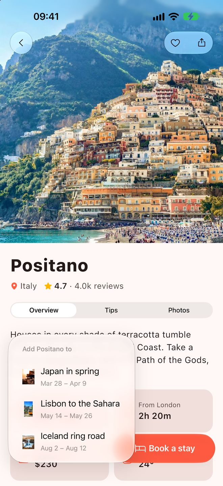
</p>

```dart
NativeMenuAnchor(
  items: [
    for (final status in statuses)
      NativeMenuItem(title: status.label, checked: status == current, onSelected: () => pick(status)),
  ],
  child: statusRow,
)
```

A tap on the child opens the native `UIMenu` growing out of it. An invisible native button
(`GlassShape(style: GlassStyle.none)`) sits over the child and takes the tap, so the child draws the
trigger but gets no touches of its own. Off iOS 26 a tap opens the Flutter menu next to it.

**Context menus** on any Flutter widget:

```dart
NativeContextMenu(
  borderRadius: BorderRadius.circular(18),
  items: [
    NativeMenuItem(title: 'Reply', icon: const NativeIcon.symbol('arrowshape.turn.up.left'), onSelected: reply),
    NativeMenuItem(title: 'Delete', icon: const NativeIcon.symbol('trash'), destructive: true, onSelected: delete),
  ],
  child: bubble,
)
```

A long press opens UIKit's context menu. The widget lifts over a blurred backdrop, with the
press shrink, haptics and the settle back. UIKit recognizes the press on the Flutter view against
where Flutter laid the widget out that frame, so it follows scrolling, and a press that moves
still scrolls. The preview is a snapshot of the widget clipped to `borderRadius`. Off iOS 26 a
long press opens the Flutter menu next to the widget.

## Glass shapes

```dart
Stack(children: [
  ListView(children: [for (final item in items) GlassShape(height: 56, label: item.name, icon: item.icon)]),
  GlassGroup(
    zIndex: 1,
    child: Row(children: [
      GlassShape(width: 56, height: 56, icon: const NativeIcon.symbol('plus'), onTap: add),
      GlassShape(width: 56, height: 56, icon: const NativeIcon.symbol('ellipsis'), menu: moreItems),
    ]),
  ),
])
```

- `GlassShape` is native `UIGlassEffect` positioned by Flutter layout every frame; its content
  (icon, label) is native too. With `onTap` it uses UIKit's interactive glass response.
- Shapes in the same `GlassGroup` merge within the group's spacing and morph out of their
  neighbours. Groups stack by `zIndex`; shapes outside a group join their route's group.
- Glass honours Flutter clips (`ClipRect`, `ClipRRect`, `ClipOval`, scroll viewports).
- Glass always draws above Flutter content: Flutter widgets placed under a shape are refracted by it.

**Glass behind Flutter content** — for surfaces whose content has to stay Flutter:

<p>
  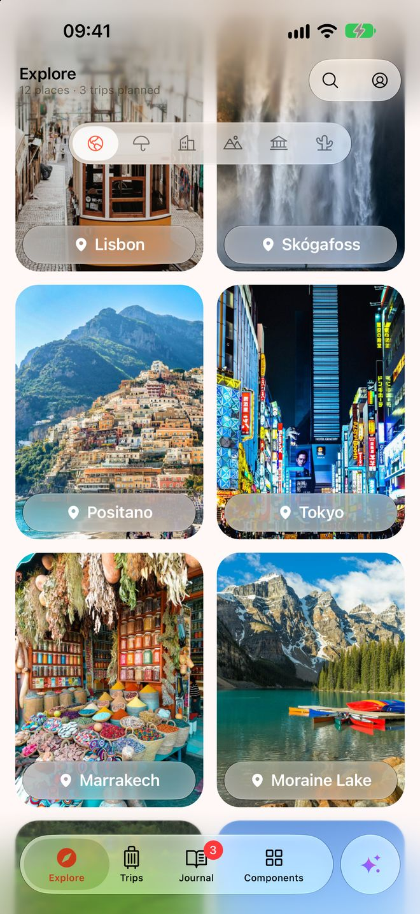
</p>

```dart
GlassBackground(
  cornerRadius: 28,
  child: Padding(padding: const EdgeInsets.all(12), child: dockContent),
)
```

`GlassBackground` is a platform view (`UIVisualEffectView` + `UIGlassEffect`) that Flutter composites
under its child, so the child can be any widget. It costs more than a shape; use `GlassShape` when the
content can be native. With `onTap` the glass is interactive and takes the tap itself (give the child
`IgnorePointer`). Off iOS 26 it is the replica surface.

## Search field

```dart
final search = GlobalKey<NativeSearchFieldState>();

NativeSearchField(
  key: search,
  placeholder: 'Search all emoji',
  controller: queryController,
  onChanged: (query) => setState(() => this.query = query),
  onSubmitted: (_) => search.currentState?.unfocus(),
)
```

- A real `UISearchTextField` inside a glass capsule, positioned by Flutter layout like a
  `GlassShape`: UIKit draws the magnifier, placeholder, clear button and caret, and owns the keyboard.
- Text flows both ways through the `controller`: typing updates it, and setting `controller.text`
  (e.g. clearing it) updates the native field. `onChanged`, `onSubmitted` and `onFocusChanged` report
  the user's edits; `NativeSearchFieldState.focus()` / `unfocus()` move the keyboard.
- `onMicrophonePressed` adds a microphone at the trailing edge while the field is empty, the way Apple's
  apps offer dictation; the clear button takes its place once there is text. Set `microphoneActive` while
  the app is listening to fill it. Dictation itself is the app's: veneer only reports the tap.
- `searchIcon`, `microphoneIcon` and `microphoneActiveIcon` swap UIKit's magnifier and microphone symbols
  for the app's own `NativeIcon`s (an icon font, an SVG), drawn at `iconSize` points.
- Off iOS 26 it renders a Flutter field of the same height on the fallback surface.

## Search toolbar

```dart
final search = GlobalKey<NativeSearchToolbarState>();

Scaffold(
  resizeToAvoidBottomInset: false,
  body: NativeSearchToolbar(
    key: search,
    placeholder: 'Search places and orders',
    controller: queryController,
    onChanged: runSearch,
    onClose: () => Navigator.pop(context),
    child: results,
  ),
)
```

- A search page's bar, the way Settings and Passwords show it on iOS 26: a real `UISearchController`
  on a navigation item with `.integrated` placement, in a `UINavigationController` whose toolbar is
  the only thing drawn. UIKit lays it out in its floating bar at the bottom, follows the keyboard up
  and down, and shows the clear button and, while searching, the close button. Dictation is the
  keyboard's own.
- It opens in search mode with the keyboard up (`autofocus`); the close button calls `onClose` after
  the bar has left search mode, typically to pop the page.
- `child` fills the screen and gets bottom padding for the space the bar takes, keyboard included,
  so results scroll underneath it and end above it. The keyboard inset is consumed, so an inner
  `Scaffold` doesn't also resize.
- Text flows both ways through the `controller`, as in [Search field](#search-field);
  `NativeSearchToolbarState.focus()` / `unfocus()` move the keyboard.
- While another route covers its page, the bar is hidden rather than removed, and comes back as it
  was left. One search toolbar is shown at a time.
- Off iOS 26 it renders a Flutter search field and close button above the keyboard.

## Segment bar

```dart
GlassSegmentBar(
  segments: const [
    GlassSegment(icon: NativeIcon.symbol('clock'), label: 'Recent'),
    GlassSegment(icon: NativeIcon.symbol('face.smiling'), label: 'Smileys'),
    GlassSegment(icon: NativeIcon.symbol('leaf'), label: 'Nature'),
  ],
  selectedIndex: section,
  onSelected: jumpToSection,
)
```

- One glass capsule holding a row of native buttons, with a highlight capsule that springs to the
  selected segment — like an emoji keyboard's category bar.
- Segments show an icon, or a short label (e.g. an emoji) when there is no icon; with an icon the
  label is its accessibility label. `foreground`, `selectedForeground` and `selectionColor` default
  to the system's secondary label, label and an adaptive light capsule.
- The bar is `segments.length * segmentWidth` wide plus its padding. Off iOS 26 it renders the same
  capsule in Flutter.

## Controls and alerts

<p>
  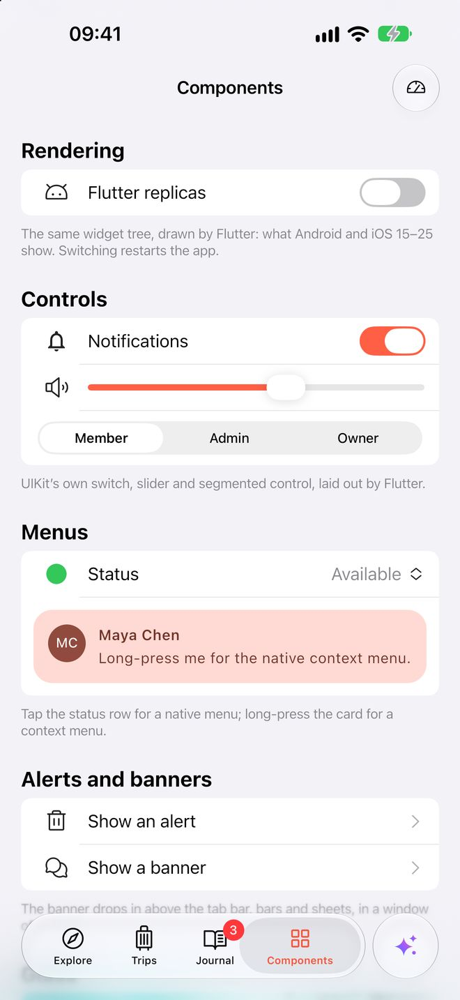
  
</p>

```dart
NativeSwitch(value: notify, onChanged: (v) => setState(() => notify = v), activeColor: brand);
NativeSlider(value: speed, min: 0, max: 4, onChanged: setSpeed);
NativeSegmentedControl(labels: const ['Member', 'Admin'], selectedIndex: role, onValueChanged: setRole);

final picked = await showNativeAlert(
  context: context,
  title: 'Delete this item?',
  tint: brand,
  actions: const [
    NativeAlertAction(title: 'Delete', style: NativeAlertActionStyle.destructive, preferred: true),
    NativeAlertAction(title: 'Cancel', style: NativeAlertActionStyle.cancel),
  ],
);
```

The controls are UIKit's own, as platform views Flutter lays out (so they work in Flutter-drawn sheets).
They're controlled: the value shown is the one you pass. `showNativeAlert` presents a
`UIAlertController` and answers with the index of the action picked. Off iOS 26 they're Flutter's
Cupertino controls and `CupertinoAlertDialog`.

## Banners

```dart
final shown = await showNativeBanner(
  title: 'launch-crew',
  trailing: 'now',
  subtitle: 'Maya Chen',
  body: 'The build is green — shipping the beta to testers this afternoon.',
  icon: const NativeIcon.symbol('bubble.left.and.bubble.right.fill'),
  badge: const NativeIcon.symbol('heart.circle.fill'),
  style: NativeBannerStyle(dark: isDark, iconBackground: brandContainer),
  onTap: openThread,
);
if (!shown) showMySnackBar(); // Android and iOS 15–25
```

<p>
  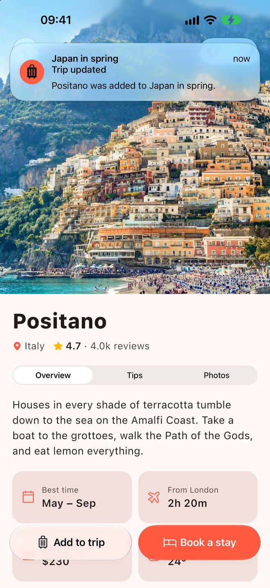
</p>

- An in-app notification on Liquid Glass that drops in from the top of the screen in a window of its
  own, so it shows above the app's navigation and tab bars and its native sheets, which Flutter
  content can't cover. VoiceOver announces it.
- Tap it for `onTap`; swipe it up to dismiss it. It leaves after `duration` (held while touched), when
  `hideNativeBanner()` is called, or when another banner replaces it; `onDismissed` runs either way.
- `NativeBannerStyle` sets its fonts, colours, glass tint, border, shadow and metrics.
- There is no Flutter replica: off iOS 26 it returns `false` so the app can show its own.

## Icons

Every icon parameter takes a `NativeIcon`, rendered natively:

| | |
|---|---|
| `NativeIcon.symbol('heart.fill')` | SF Symbol |
| `NativeIcon.icon(Icons.add)` | Any `IconData`: Material, Cupertino, package or custom icon fonts, and variable fonts (`fill`, `weight`, `grade`, `opticalSize`) |
| `NativeIcon.svgAsset('assets/x.svg')`, `.svgFile(path)`, `.svg(markup)` | SVG, drawn by Veneer's native renderer (CSS, gradients, clip paths, masks, `use`, text…) |
| `NativeIcon.image('assets/photo.jpg')`, `.imageFile(path)` | Raster images in their own colours |

Glyphs and SVGs are template images that tint like SF Symbols; pass `tinted: false` to keep an
SVG's own colours. Release builds tree-shake icon fonts down to the `const` `IconData`s you use,
as with `Icon`. Off iOS 26, SF Symbols map to close Material icons (override with
`NativeIcon.symbol(name, fallback: …)`).
